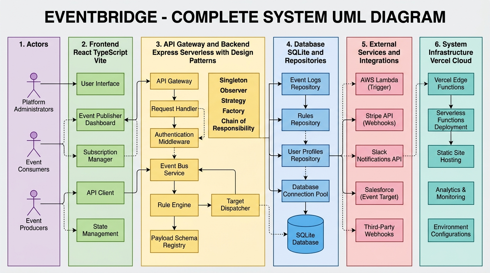
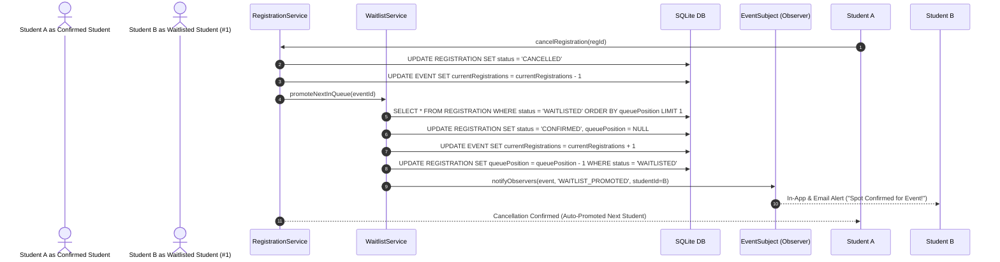

# EventBridge — University Event Discovery & Registration Platform

EventBridge is a full-stack web application designed to solve the fragmented event discovery and registration process across collegiate campuses. It provides institutional isolation, granular access control, registration validation, and automated FIFO waitlist management.

---

## Live Deployment & Demo

🚀 **Production Web App:** [https://event-bridge-beta.vercel.app/](https://event-bridge-beta.vercel.app/)

The application is deployed on **Vercel** with full client-side React routing and serverless backend API endpoints powered by an in-memory/disk-synchronized SQLite WASM database (`sql.js`).

---

## Demo Accounts

All demo accounts share the password: `password123` (Admin: `admin123`).

| Role | Username | Affiliation | Purpose |
| :--- | :--- | :--- | :--- |
| **Student** | `bhumika_rbu` | Ramdeobaba University (RBU) | Discover and register for RBU intra events and inter-college events |
| **Student** | `aarav_rcoem` | RCOEM Nagpur | Discover and register for RCOEM intra events and inter-college events |
| **Student** | `student1` ... `student93` | Multiple Institutions | Test waitlisting, concurrent registration, and automated queue promotions |
| **Organizer** | `org_rbu` | RBU Tech Cell | Create draft events, submit for review, broadcast announcements, view rosters |
| **Organizer** | `org_rcoem` | RCOEM Cultural Club | Manage cultural events and inspect waitlists |
| **Admin** | `admin` | Platform Wide | System governance, event moderation review desk (Approve / Reject), college registration |

---

## 🎯 The Problem Solved

In collegiate ecosystems, campus event discovery and attendance management suffer from three core issues:
1. **Scattered Information**: Announcements are scattered across WhatsApp groups, email blasts, and physical posters, causing low visibility and missed registration deadlines.
2. **Access Control Leakage**: Organizers struggle to enforce institutional boundaries (e.g. restricting an internal workshop strictly to host-college students while opening hackathons to other universities).
3. **Overbooking & Manual Waitlisting**: When high-demand events hit capacity, manual waitlist tracking leads to confusion, double registrations, and empty seats when confirmed students drop out last minute.

**EventBridge** addresses these challenges through a unified platform featuring college-based visibility isolation, a sequential 6-stage validation pipeline, and an atomic FIFO waitlist with automatic promotion upon cancellation.

---

## 🏗️ System Architecture

```text
                    ┌─────────────────────────┐
                    │     Frontend (React)     │
                    │  Vite + TypeScript + UI │
                    └────────────┬────────────┘
                                 │ HTTP / REST
                    ┌────────────▼────────────┐
                    │   Express Controllers   │
                    │  (Req/Res, Status Codes)│
                    └────────────┬────────────┘
                                 │
              ┌──────────────────▼──────────────────┐
              │           Service Layer             │
              │  EventService    RegistrationService│
              │  WaitlistService NotificationService│
              └─────────────┬───────────┬───────────┘
                            │           │
              ┌─────────────▼──┐    ┌───▼───────────┐
              │   Repositories │    │Design Patterns│
              │ (DAOs, Queries)│    │• Factory      │
              └─────────────┬──┘    │• Chain of Resp│
                            │       │• Proxy        │
                            │       │• Observer     │
                            │       └───────────────┘
              ┌─────────────▼───────────┐
              │     Database Layer      │
              │ SQLite (Atomic / WASM)  │
              └─────────────────────────┘
```

<div align="center">
  
</div>

---

## Core Features & Workflows

### 1. Waitlist & Automatic FIFO Promotion 
When an event reaches capacity limit (`currentRegistrations >= capacity`):
- Additional registrants are automatically placed on a FIFO waitlist (`status = 'WAITLISTED'`) and assigned a real-time queue position (`queuePosition = 1, 2, 3...`).
- When a confirmed attendee cancels their registration, `WaitlistService` immediately and atomically promotes the student at the front of the queue (`queuePosition = 1`) to `CONFIRMED`.
- The `Observer Pattern` dispatches high-priority in-app and simulated email notifications to the promoted student.
- Remaining waitlisted candidates have their queue positions shifted forward automatically.



---

### 2. Event Lifecycle & Administrative Review State Machine
Events follow a disciplined lifecycle with moderation governance:

```text
DRAFT ──────────────► SUBMITTED ──────────────► APPROVED ──────────────► PUBLISHED ──────────────► COMPLETED / CANCELLED
                            ▲                         │
                            │                         ▼
                            └─── Organizer Edits ◄── REJECTED (with rejectionReason)
```

- **Organizer Drafts**: Organizers create events in `DRAFT` status and can refine schedules and venue requirements before submitting.
- **Moderation Desk**: Platform Admins review `SUBMITTED` events. Admins can either Approve (instantly publishes to the live feed) or Reject with specific feedback (`rejectionReason`).
- **Resubmission Flow**: If rejected, organizers view admin feedback on their dashboard, update the event details, and re-submit for review.

---

### 3. 6-Stage Registration Validation Chain (Chain of Responsibility)
When a student attempts registration, the request traverses 6 sequential handlers. If any check fails, the pipeline halts immediately and returns a user-friendly explanation:

```text
1. AuthCheckHandler         ──► Verifies valid student JWT and STUDENT role
           │ Pass
2. EventStatusHandler       ──► Ensures event is in PUBLISHED state
           │ Pass
3. VisibilityCheckHandler   ──► Blocks students from other colleges if INTRA_COLLEGE
           │ Pass
4. CollegeEligibilityHandler──► Enforces institutional affiliation requirements
           │ Pass
5. DeadlineCheckHandler     ──► Validates current timestamp against registrationDeadline
           │ Pass
6. DuplicateRegistration    ──► Prevents double-registration (returns HTTP 409)
           │ Pass
     Atomic Capacity & Waitlist Router
```

---

### 4. College-Based Access Control & Event Visibility (Proxy Pattern)
The `EventAccessProxy` intercepts all data-layer repository queries:
- **`INTRA_COLLEGE` Events**: Visible strictly to enrolled students of the host institution and platform admins. Hidden from external students and unauthenticated guests.
- **`INTER_COLLEGE` Events**: Visible to all verified students across participating colleges.
- **Draft Shielding**: `DRAFT`, `SUBMITTED`, and `REJECTED` events are shielded from students and only accessible by the creating organizer and platform admins.

---

## Key Design Decisions & Rationale

| Pattern | Where Applied | Why Used (Direct Technical Rationale) |
| :--- | :--- | :--- |
| **Factory Method** | `EventFactory` (`Technical`, `Cultural`, `Sports`, `Workshop`, `Seminar`) | Encapsulates domain defaults and eligibility guidelines per category without repetitive controller code. |
| **Chain of Responsibility** | `RegistrationValidationChain` (6 Handlers) | Decouples individual validation rules (auth, status, visibility, deadline, duplicate) into isolated, testable, single-responsibility classes. |
| **Proxy Pattern** | `EventAccessProxy` | Enforces college-based visibility and shields unapproved drafts at the repository boundary before returning data. |
| **Observer Pattern** | `EventSubject` (`RegisteredStudentsObserver`, `OrganizerObserver`, `AdminAuditObserver`) | Decouples side-effect notification dispatches from core registration and waitlist business logic. |
| **Singleton Pattern** | `DatabaseManager`, `EventSubject` | Guarantees a single database connection and event bus instance across concurrent requests. |

---

## ⚡ Technical Challenges & Solutions

### 1. Preventing Race Conditions in Concurrent Registrations & Waitlist Promotion
- **Problem**: When an event has 1 remaining seat (`99/100`) and two concurrent registration requests arrive simultaneously, a naive check-then-insert pattern could result in overbooking (`101/100`).
- **Solution**: SQLite operations serialize through an asynchronous promise queue and transaction lock in `DatabaseManager`. All capacity checks and waitlist queue insertions execute within atomic transactions.

### 2. Derived Registration Status
- **Problem**: Storing a boolean `isRegistrationOpen` flag in the database creates stale data when registration deadlines expire without a background worker actively mutating the table.
- **Solution**: `isRegistrationOpen` is dynamically derived at the service layer:
  $$\text{isRegistrationOpen} = (\text{status} = \text{'PUBLISHED'}) \land (\text{now} \ge \text{registrationStartTime}) \land (\text{now} \le \text{registrationDeadline})$$

### 3. Serverless SQLite WASM Persistence
- **Problem**: Running SQLite on serverless platforms (like Vercel) lacks native file persistence.
- **Solution**: `DatabaseManager` loads `sql.js` WASM binaries dynamically with in-memory execution and writes snapshots to `/tmp/eventbridge.db` on disk updates.

---

## 🧪 Automated Test Suite

EventBridge includes 5 modular, independent test suites in `backend/tests/`:

```text
backend/tests/
├── event.test.ts          # Event creation, category defaults, validation
├── lifecycle.test.ts      # Draft -> Submitted -> Approved/Rejected -> Published flow
├── authorization.test.ts  # Proxy isolation & RBAC enforcement
├── registration.test.ts   # Validation chain, duplicate prevention, deadline checks
└── waitlist.test.ts       # Capacity limits, waitlist queuing, and cancellation auto-promotion
```

### Running Tests Locally:

```bash
cd backend
npm test
```

### Test Suite Execution Output:
```text
====================================================
🚀 EVENTBRIDGE AUTOMATED TEST RUNNER
====================================================

[INFO] Starting EventBridge Database Seeding...
[INFO] Database seeding completed successfully.

🧪 Running Suite: Event Factory & Creation Tests...
✅ Event Factory & Creation Tests Passed!

🧪 Running Suite: Event Lifecycle & Approval State Machine Tests...
✅ Event Lifecycle & Approval State Machine Tests Passed!

🧪 Running Suite: Proxy Pattern & College Isolation Authorization Tests...
✅ Proxy Pattern & College Isolation Authorization Tests Passed!

🧪 Running Suite: Registration Validation Chain & Duplicate Protection Tests...
✅ Registration Validation Chain & Duplicate Protection Tests Passed!

🧪 Running Suite: Waitlist Management & Auto-Promotion Tests...
✅ Waitlist Management & Auto-Promotion Tests Passed!

====================================================
🎉 ALL 5 TEST SUITES PASSED SUCCESSFULLY (100% GREEN)
====================================================
```

---

## 🚀 Local Development Setup

### Prerequisites
- **Node.js**: v18.0.0 or higher
- **npm**: v9.0.0 or higher

### 1. Clone the Repository
```bash
git clone https://github.com/Bhumika197/EventBridge.git
cd EventBridge
```

### 2. Backend Setup
```bash
cd backend
npm install
npm run seed       # Seeds 6 colleges, 100 users, and sample events
npm run dev        # Starts backend server on http://localhost:5000
```

### 3. Frontend Setup
```bash
cd ../frontend
npm install
npm run dev        # Starts Vite dev server on http://localhost:5173
```

---

## 📡 REST API Reference

| Endpoint | Method | Role | Description |
| :--- | :--- | :--- | :--- |
| `/api/auth/login` | `POST` | Public | Authenticates user and returns JWT token |
| `/api/auth/register` | `POST` | Public | Student account registration with institutional domain check |
| `/api/auth/me` | `GET` | Authenticated | Fetches current user profile and role |
| `/api/events` | `GET` | Public / Auth | Returns paginated events with search and category filters |
| `/api/events/eligible` | `GET` | Public / Auth | Returns events filtered by user eligibility via `EventAccessProxy` |
| `/api/events/pending-reviews` | `GET` | Platform Admin | Fetches submitted events awaiting moderation |
| `/api/events` | `POST` | Organizer / Admin | Creates a new event (defaults to `DRAFT`) |
| `/api/events/:id/submit` | `POST` | Organizer | Submits draft or rejected event for admin review |
| `/api/events/:id/review` | `POST` | Platform Admin | Approves (`PUBLISHED`) or Rejects (with reason) an event |
| `/api/events/:id/cancel` | `POST` | Organizer / Admin | Cancels an event and notifies registered students |
| `/api/registrations/event/:id` | `POST` | Student | Registers for event or joins waitlist if capacity is reached |
| `/api/registrations/:id` | `DELETE` | Student | Cancels registration and triggers auto-promotion of next waitlisted student |
| `/api/registrations/my-registrations` | `GET` | Student | Returns student's confirmed and waitlisted events |
| `/api/registrations/notifications` | `GET` | Authenticated | Returns in-app notifications and announcements |
| `/api/admin/stats` | `GET` | Platform Admin | Returns platform metrics and enrollment statistics |

---

## 🔮 Future Improvements

- **QR Code Attendance Verification**: Generate dynamic cryptographic QR codes for fast mobile check-ins at event entrances.
- **Webhook Integrations**: Enable organizers to receive instant Discord/Slack notifications when event registrations hit milestones.
- **Team / Group Registrations**: Support multi-student hackathon and sports squad registrations under a single team captain.
