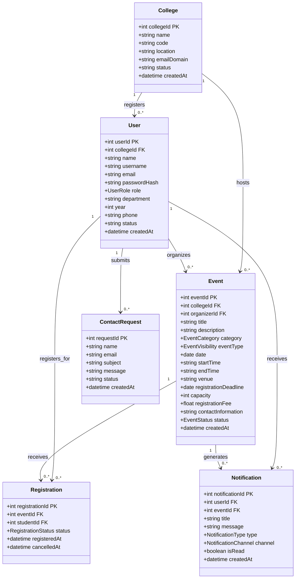
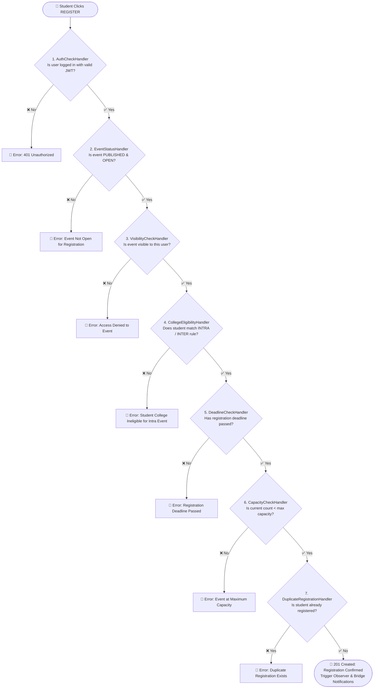

# EventBridge – College-Integrated Inter-College Event Discovery & Registration Platform

[](https://event-bridge-beta.vercel.app/)
[](https://www.typescriptlang.org/)
[](https://reactjs.org/)
[](https://event-bridge-beta.vercel.app/)

EventBridge is a centralized, full-stack web platform for college students, organizers, and platform administrators to discover, manage, and register for campus events across multiple institutions.

> **Academic Project Note**: Designed for Software Engineering & Design Pattern evaluation, enforcing clean Object-Oriented Architecture and explicit design patterns (Singleton, Chain of Responsibility, Factory Method, Proxy, Abstract Factory, Bridge, Observer, Database Connectivity).

---

## 🌐 Live Deployment

🚀 **Live Application:** [https://event-bridge-beta.vercel.app/](https://event-bridge-beta.vercel.app/)

The project is deployed on **Vercel** with full client-side React routing and serverless backend API endpoints powered by an in-memory SQL database (`sql.js`).

---

## 🔑 Sample Demo Accounts

All sample passwords are: `password123` (Admin: `admin123`).

| Role | Username | College | Description |
| :--- | :--- | :--- | :--- |
| **Student** | `student_nvu` | North Valley University | Student eligible for NVU Intra & Inter events |
| **Student** | `student_git` | Greenfield Institute of Tech | Student eligible for GIT Intra & Inter events |
| **Student** | `student_cac` | City Arts College | Fine Arts Student eligible for CAC & Inter events |
| **Organizer** | `org_nvu` | North Valley University | Tech Event Organizer |
| **Organizer** | `org_git` | Greenfield Institute of Tech | Robotics & Hackathon Organizer |
| **Admin** | `admin` | Platform Wide | System Administrator (Manage colleges & users) |

---

## ✨ Key Features

- **College-Integrated Event Visibility**:
  - **INTRA_COLLEGE**: Restricted strictly to students of the organizing institution. Excluded from default eligible feeds of students from other colleges.
  - **INTER_COLLEGE**: Open to students across all registered institutions, subject to eligibility criteria.
- **7-Stage Validation Chain (Chain of Responsibility)**:
  - Sequential validation when clicking REGISTER: `AuthCheckHandler` → `EventStatusHandler` → `VisibilityCheckHandler` → `CollegeEligibilityHandler` → `DeadlineCheckHandler` → `CapacityCheckHandler` → `DuplicateRegistrationHandler`.
- **Dynamic Category Factories (Factory Method & Abstract Factory)**:
  - Instantializes events and category-specific policy components (Technical, Cultural, Sports, Literary, Arts, Management, Workshops, Social/Community).
- **Access Control Proxy (Proxy Pattern)**:
  - Wraps repository queries to filter restricted intra-college events and enforce role permissions.
- **Decoupled Notifications (Bridge & Observer Patterns)**:
  - Observer notifies registered students on event changes; Bridge decouples notification types (`RegistrationConfirmation`, `EventUpdated`, `EventCancelled`, `OrganizerAnnouncement`) from delivery channels (`InAppChannel`, `EmailChannel`, `SMSChannel`).
- **Interactive Design Pattern & UML Explorer**:
  - Built-in UI tab displaying pattern problem-solution breakdowns, source file links, code snippets, and all 10 UML diagram specifications.

---

## 📊 Complete System UML & Architectural Diagram

```mermaid
flowchart TB
    %% 1. ACTORS SECTION
    subgraph S1["1. ACTORS"]
        Guest["👤 Guest (Unauthenticated User)<br/>• Browse public events<br/>• View event details<br/>• Search & filter events"]
        Student["🎓 Student (Registered User)<br/>• Manage profile & college link<br/>• Discover eligible events<br/>• Register for events<br/>• View registrations<br/>• Receive notifications"]
        Organizer["👔 Organizer (Event Lead)<br/>• Create & publish events<br/>• Manage event updates<br/>• Broadcast announcements<br/>• View participant rosters"]
        Admin["🛡️ Admin (Platform Admin)<br/>• Manage colleges & domains<br/>• User management & roles<br/>• System oversight & audit<br/>• View platform analytics"]
    end

    %% 2. FRONTEND CLIENT
    subgraph S2["2. FRONTEND (React 18 + TypeScript + Vite + Tailwind CSS)"]
        subgraph F_Routes["2.1 Pages & Routes"]
            P_Home["/ (HomePage)"]
            P_Events["/events (EventsPage)"]
            P_Detail["/events/:id (EventDetailPage)"]
            P_Login["/login (LoginPage)"]
            P_Reg["/register (RegisterPage)"]
            P_MyReg["/my-registrations (MyRegistrationsPage)"]
            P_Create["/organizer/create (CreateEventPage)"]
            P_Admin["/admin (AdminDashboardPage)"]
            P_Patterns["/patterns (PatternsExplorerPage)"]
            P_Contact["/contact (ContactPage)"]
        end

        subgraph F_Layout["2.2 Shared Layout & Contexts"]
            L_Nav["Navbar & Header"]
            L_Foot["Footer"]
            L_Auth["AuthContext (JWT Session)"]
            L_Notif["NotificationDropdown"]
            L_Toast["ToastNotificationProvider"]
        end

        subgraph F_Comp["2.3 UI Components"]
            C_Card["EventCard"]
            C_Search["SearchBar & FilterSidebar"]
            C_Modal["RegistrationModal"]
            C_Chain["ChainDebuggerVisualizer"]
            C_PatView["DesignPatternViewer"]
            C_Stats["AnalyticsStatsGrid"]
        end

        subgraph F_State["2.4 State Management & Client Services"]
            S_Auth["authService (JWT Storage)"]
            S_Event["eventService (API Client)"]
            S_Reg["registrationService"]
            S_Notif["notificationService"]
        end
    end

    %% 3. BACKEND & API GATEWAY
    subgraph S3["3. API GATEWAY & BACKEND (Express.js / Vercel Serverless)"]
        subgraph B_Routes["3.1 REST API Routes"]
            R_Auth["POST /api/auth/login<br/>POST /api/auth/register<br/>GET /api/auth/me"]
            R_Event["GET /api/events/eligible<br/>GET /api/events/:id<br/>POST /api/events<br/>PUT /api/events/:id<br/>POST /api/events/:id/announcement"]
            R_Reg["POST /api/registrations/event/:id<br/>GET /api/registrations/my-registrations<br/>DELETE /api/registrations/:id"]
            R_Admin["GET /api/admin/stats<br/>POST /api/admin/colleges<br/>GET /api/admin/users"]
            R_Pat["GET /api/patterns<br/>GET /api/patterns/:id"]
            R_Cont["POST /api/contact"]
        end

        subgraph B_Ctrl["3.2 Controllers"]
            Ctrl_Auth["AuthController"]
            Ctrl_Event["EventController"]
            Ctrl_Reg["RegistrationController"]
            Ctrl_Admin["AdminController"]
            Ctrl_Pat["PatternInfoController"]
            Ctrl_Cont["ContactController"]
        end

        subgraph B_Serv["3.3 Services & Business Logic"]
            S_AuthServ["AuthService (Password verification, JWT)"]
            S_EventServ["EventService (Event lifecycle, Filtering)"]
            S_RegServ["RegistrationService (Execution orchestrator)"]
            S_NotifServ["NotificationService (Multi-channel dispatch)"]
        end

        subgraph B_Mid["3.4 Middleware & Guards"]
            M_Auth["authMiddleware (JWT Verification)"]
            M_Role["roleMiddleware (RBAC Access Control)"]
            M_Valid["validationMiddleware (Input Sanitize)"]
            M_Error["errorMiddleware (Global Handler)"]
        end

        subgraph B_Pat["3.5 Core Design Pattern Engines"]
            DP_Singleton["Singleton: DatabaseManager"]
            DP_Chain["Chain of Responsibility: RegistrationValidationChain<br/>(7-Stage Sequential Rule Handlers)"]
            DP_Factory["Factory Method: EventFactory<br/>(Technical, Cultural, Sports, etc.)"]
            DP_AbsFact["Abstract Factory: EventComponentFactory<br/>(Event + Policies Families)"]
            DP_Proxy["Proxy: EventAccessProxy<br/>(Institution Access Control)"]
            DP_Bridge["Bridge: NotificationBridge<br/>(Types decoupled from Channels)"]
            DP_Observer["Observer: EventSubject<br/>(Broadcast alerts on change)"]
        end
    end

    %% 4. DATABASE & REPOSITORIES
    subgraph S4["4. DATABASE & DATA ACCESS LAYER (SQLite / sql.js)"]
        subgraph D_DAO["4.1 Repositories (DAO Pattern)"]
            DAO_College["CollegeRepository"]
            DAO_User["UserRepository"]
            DAO_Event["EventRepository"]
            DAO_Reg["RegistrationRepository"]
            DAO_Notif["NotificationRepository"]
            DAO_Contact["ContactRequestRepository"]
        end

        subgraph D_Schema["4.2 Database Tables & Schemas"]
            T_College["COLLEGE<br/>• collegeId (PK)<br/>• name, code<br/>• emailDomain, location"]
            T_User["USER<br/>• userId (PK)<br/>• collegeId (FK)<br/>• username, email, passwordHash<br/>• role (STUDENT/ORGANIZER/ADMIN)"]
            T_Event["EVENT<br/>• eventId (PK)<br/>• collegeId (FK), organizerId (FK)<br/>• title, category, eventType<br/>• date, venue, capacity, deadline"]
            T_Reg["REGISTRATION<br/>• registrationId (PK)<br/>• eventId (FK), studentId (FK)<br/>• status, registeredAt"]
            T_Notif["NOTIFICATION<br/>• notificationId (PK)<br/>• userId (FK), eventId (FK)<br/>• type, channel, message, isRead"]
            T_Contact["CONTACT_REQUEST<br/>• requestId (PK)<br/>• name, email, message"]
        end
    end

    %% 5. EXTERNAL SERVICES
    subgraph S5["5. EXTERNAL SERVICES & INTEGRATIONS"]
        EXT_JWT["🔐 JWT & Bcrypt<br/>Token Auth & Hash"]
        EXT_DB["💾 sql.js / SQLite<br/>In-Memory SQL Engine"]
        EXT_Email["📧 Nodemailer<br/>Email Notifications"]
        EXT_SMS["📱 SMS Gateway<br/>SMS Channel (Simulated)"]
        EXT_Vercel["⚡ Vercel Serverless<br/>Cloud Functions & Edge"]
    end

    %% 6. INFRASTRUCTURE
    subgraph S6["6. SYSTEM INFRASTRUCTURE (Vercel + Cloud)"]
        INF_Client["🖥️ Client Browser<br/>(HTTPS / SSL)"]
        INF_Edge["🌐 Vercel Edge Network<br/>(Global CDN)"]
        INF_Frontend["⚛️ React Single Page App<br/>(Client-Side Router)"]
        INF_Serverless["⚡ Vercel Serverless API<br/>(/api Express Router)"]
        INF_Storage["💾 In-Memory SQLite DB<br/>(sql.js WASM Engine)"]
    end

    %% CONNECTORS / FLOWS
    Guest --> P_Home & P_Events
    Student --> P_Events & P_Detail & P_MyReg & P_Contact
    Organizer --> P_Create & P_Detail
    Admin --> P_Admin

    P_Home & P_Events & P_Detail & P_Login & P_Reg & P_MyReg & P_Create & P_Admin & P_Patterns & P_Contact --> S_Auth & S_Event & S_Reg & S_Notif

    S_Auth & S_Event & S_Reg & S_Notif --> R_Auth & R_Event & R_Reg & R_Admin & R_Pat & R_Cont

    R_Auth --> M_Auth --> Ctrl_Auth --> S_AuthServ
    R_Event --> M_Auth --> Ctrl_Event --> S_EventServ
    R_Reg --> M_Auth --> Ctrl_Reg --> S_RegServ
    R_Admin --> M_Role --> Ctrl_Admin
    R_Pat --> Ctrl_Pat

    S_AuthServ --> DAO_User
    S_EventServ --> DP_Proxy --> DAO_Event
    S_EventServ --> DP_Factory & DP_AbsFact
    S_EventServ --> DP_Observer --> DP_Bridge
    S_RegServ --> DP_Chain --> DAO_Reg
    S_RegServ --> DP_Bridge --> DAO_Notif

    DAO_College --> T_College
    DAO_User --> T_User
    DAO_Event --> T_Event
    DAO_Reg --> T_Reg
    DAO_Notif --> T_Notif
    DAO_Contact --> T_Contact

    T_College & T_User & T_Event & T_Reg & T_Notif & T_Contact --> DP_Singleton --> EXT_DB

    DP_Bridge --> EXT_Email & EXT_SMS
    S_AuthServ --> EXT_JWT

    INF_Client --> INF_Edge --> INF_Frontend
    INF_Client -- REST API Calls --> INF_Serverless --> INF_Storage
```



---

### 🗂️ Domain Entities & Database Class Diagram



---

### ⚡ 7-Stage Validation Chain (Chain of Responsibility Pattern)



---

### 📋 Key Enums, Types & Relationship Matrix

| Key Enum / Type | Values / Variants | Purpose |
| :--- | :--- | :--- |
| **`UserRole`** | `STUDENT`, `EVENT_ORGANIZER`, `PLATFORM_ADMIN` | Role-Based Access Control (RBAC) and permissions |
| **`EventVisibility`** | `INTRA_COLLEGE`, `INTER_COLLEGE` | Determines multi-tenant event discovery and registration boundaries |
| **`EventCategory`** | `Technical`, `Cultural`, `Sports`, `Literary`, `Arts`, `Management`, `Workshops`, `Social/Community` | Factory Method instantiation selector & policy resolution |
| **`EventStatus`** | `DRAFT`, `PUBLISHED`, `REGISTRATION_OPEN`, `REGISTRATION_CLOSED`, `ONGOING`, `COMPLETED`, `CANCELLED` | Lifecycle state machine for events |
| **`RegistrationStatus`**| `CONFIRMED`, `CANCELLED`, `WAITLISTED` | Status of student event participation |
| **`NotificationChannel`**| `IN_APP`, `EMAIL`, `SMS` | Delivery channels managed by the Bridge pattern |

| Cardinality / Association | Relationship Description |
| :--- | :--- |
| **`College 1 ──< 0..* User`** | An institution registers multiple students and organizers. |
| **`College 1 ──< 0..* Event`** | An institution hosts both intra-college and inter-college events. |
| **`User (Organizer) 1 ──< 0..* Event`** | An organizer creates, updates, and manages multiple event listings. |
| **`User (Student) 1 ──< 0..* Registration`**| A student can register for multiple events across institutions. |
| **`Event 1 ──< 0..* Registration`** | An event maintains an active roster of registered student participants. |
| **`User 1 ──< 0..* Notification`** | Users receive targeted notifications across in-app, email, and SMS channels. |
| **`Event 1 ──< 0..* Notification`** | Event updates and announcements trigger automatic subscriber broadcasts. |

---

## 📐 Design Pattern Architecture Overview

| Pattern | Implementation Class | Location | Description |
| :--- | :--- | :--- | :--- |
| **1. Singleton** | `DatabaseManager` | `backend/src/db/DatabaseManager.ts` | Encapsulates single SQLite database connection |
| **2. Chain of Responsibility** | `RegistrationValidationChain` | `backend/src/patterns/chain/` | Sequential 7-step registration validation chain |
| **3. Factory Method** | `EventFactory` | `backend/src/patterns/factory/EventFactory.ts` | Encapsulates category-specific event creation |
| **4. Proxy** | `EventAccessProxy` | `backend/src/patterns/proxy/EventAccessProxy.ts` | Enforces college-based visibility and access rules |
| **5. Abstract Factory** | `EventComponentFactory` | `backend/src/patterns/abstractFactory/` | Creates related families (Event, RegPolicy, EligPolicy) |
| **6. Bridge** | `NotificationBridge` | `backend/src/patterns/bridge/NotificationBridge.ts` | Decouples notification types from channels (InApp, Email, SMS) |
| **7. Observer** | `EventSubject` | `backend/src/patterns/observer/EventSubject.ts` | Dispatches event change alerts to registered students |
| **8. Database Connectivity** | `Repository Classes` | `backend/src/repositories/` | Decoupled Data Access Objects for database persistence |

📖 *For full design pattern breakdowns and UML diagrams, check [DESIGN_PATTERNS.md](file:///c:/Users/HP/OneDrive/Desktop/EventBridge/DESIGN_PATTERNS.md), [JAVA_DESIGN_PATTERNS.md](file:///c:/Users/HP/OneDrive/Desktop/EventBridge/JAVA_DESIGN_PATTERNS.md), and [UML_DIAGRAMS.md](file:///c:/Users/HP/OneDrive/Desktop/EventBridge/UML_DIAGRAMS.md).*

---

## 🛠️ Local Setup Instructions

### Prerequisites
- Node.js (v18+)
- npm (v9+)

### Installation & Launch

1. **Clone / Navigate to Project Directory**:
   ```bash
   cd EventBridge
   ```

2. **Start Backend Server**:
   ```bash
   cd backend
   npm install
   npm run dev
   ```
   The backend server runs on `http://localhost:5000`.

3. **Start Frontend Client**:
   ```bash
   cd ../frontend
   npm install
   npm run dev
   ```
   The frontend application runs on `http://localhost:3000`.

---

## 📡 API Documentation

- `POST /api/auth/login` - User login
- `POST /api/auth/register` - Student registration
- `GET /api/events/eligible` - Fetch user-eligible events (filtered by Proxy)
- `GET /api/events/:id` - Fetch detailed event metadata
- `POST /api/events` - Create event (Organizer only)
- `POST /api/registrations/event/:eventId` - Register student (Runs Chain of Responsibility)
- `GET /api/registrations/my-registrations` - Student's active registrations
- `POST /api/events/:id/announcement` - Broadcast organizer announcement (Observer + Bridge)
- `GET /api/patterns` - Metadata for Design Pattern & UML Explorer
