# EventBridge – Complete UML Diagram Specifications

This document provides formal Mermaid / PlantUML specifications for all 10 UML diagrams representing the EventBridge architecture.

---

## 1. Use Case Diagram

```mermaid
gantt
```
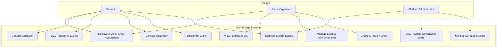

---

## 2. Class Diagram

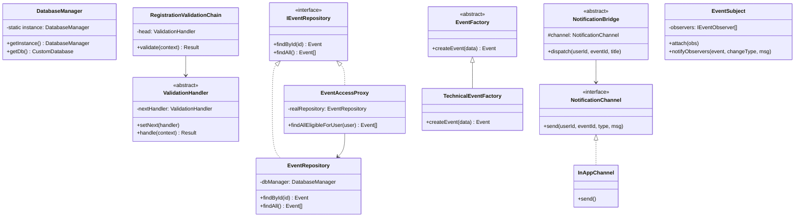

---

## 3. Sequence Diagram – Student Login

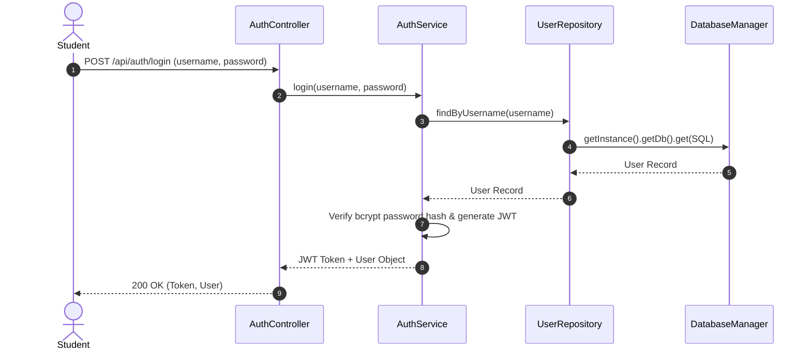

---

## 4. Sequence Diagram – Event Discovery (Proxy Pattern)

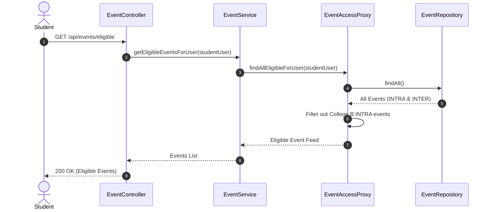

---

## 5. Sequence Diagram – Registration Workflow (Chain of Responsibility)

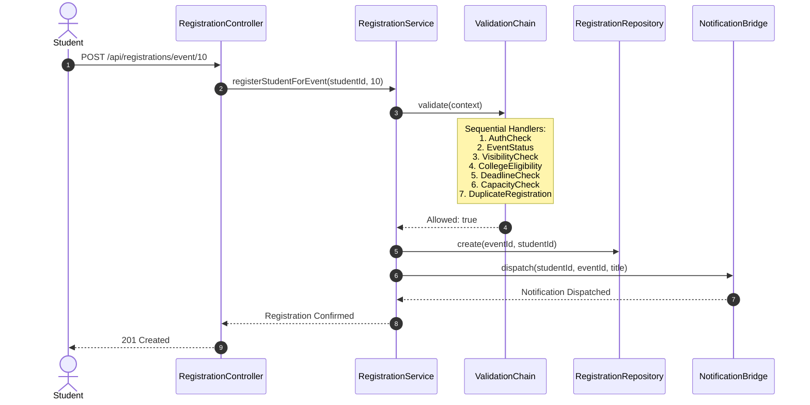

---

## 6. Sequence Diagram – Event Update & Observer Pattern

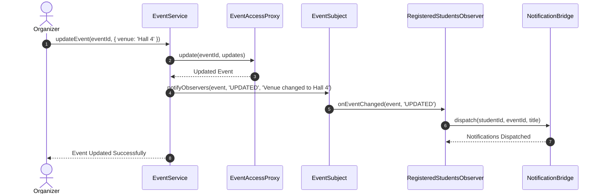

---

## 7. Activity Diagram – Registration Workflow

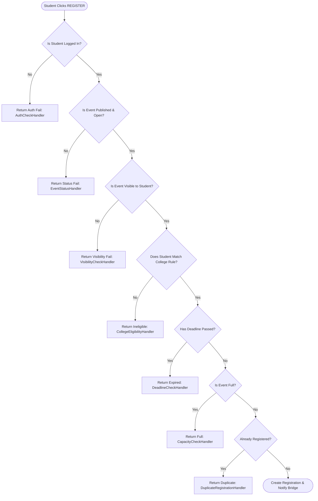

---

## 8. State Diagram – Event Lifecycle

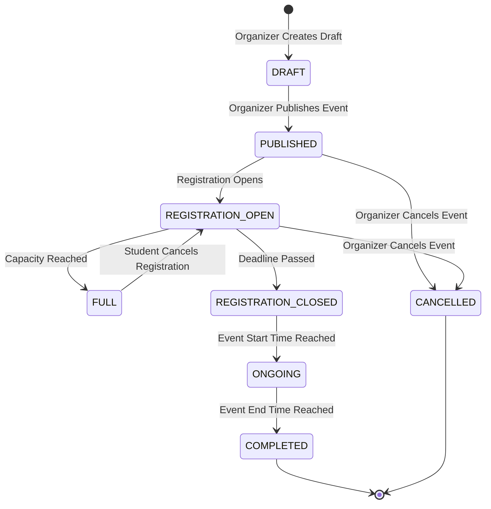

---

## 9. Component Diagram

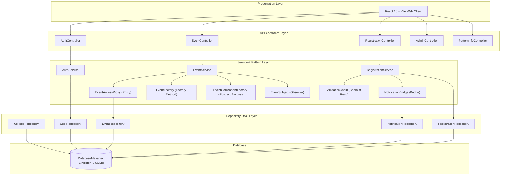

---

## 10. Deployment Diagram

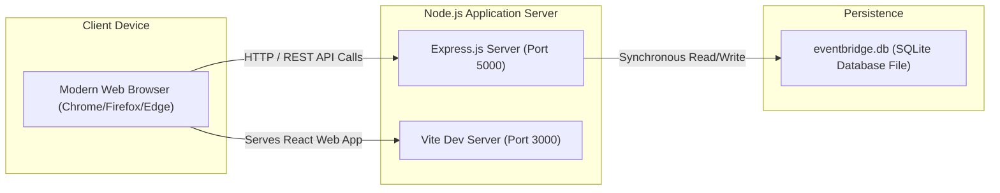

---

## 11. Builder Pattern Diagram (EventBuilder)

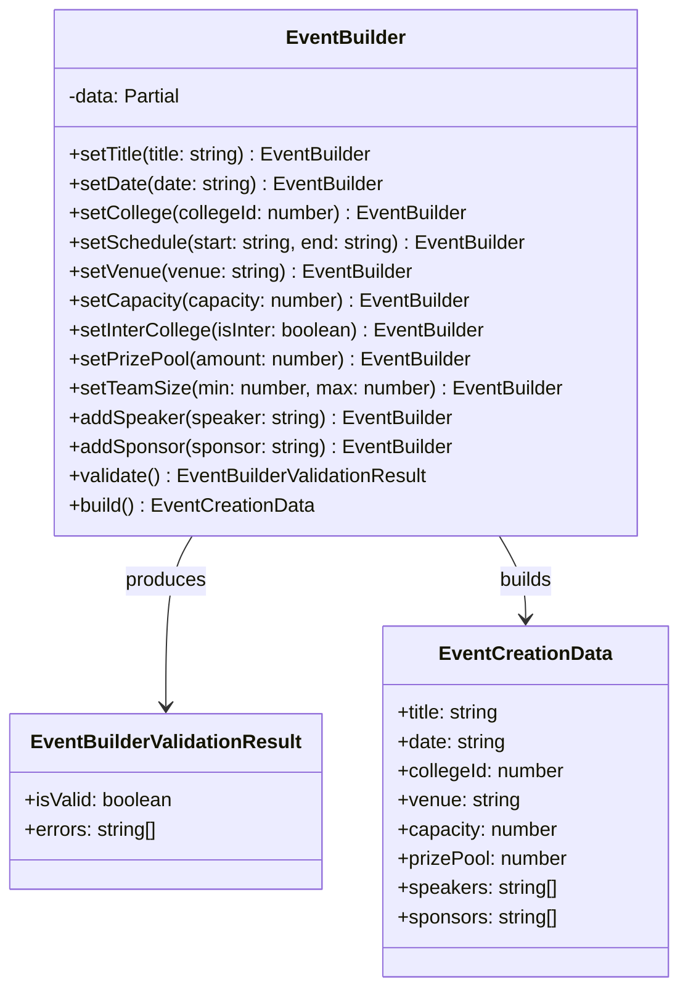

---

## 12. Prototype Pattern Diagram (EventPrototype)

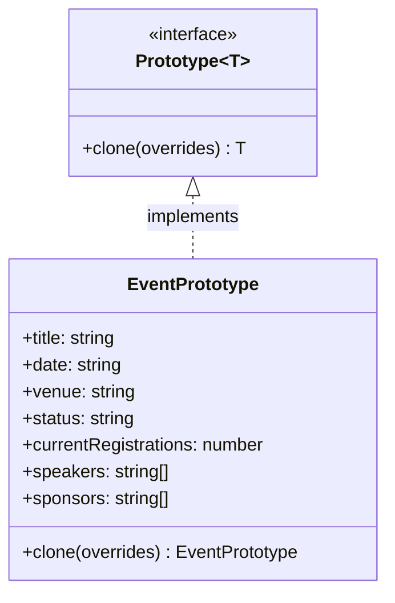

---

## 13. Mediator Pattern Diagram (EventCoordinator)

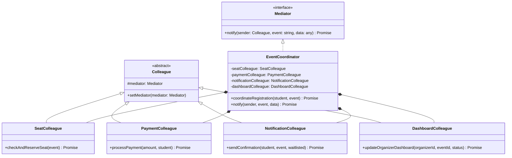

---

## 14. Template Method Pattern Diagram (EventWorkflow)

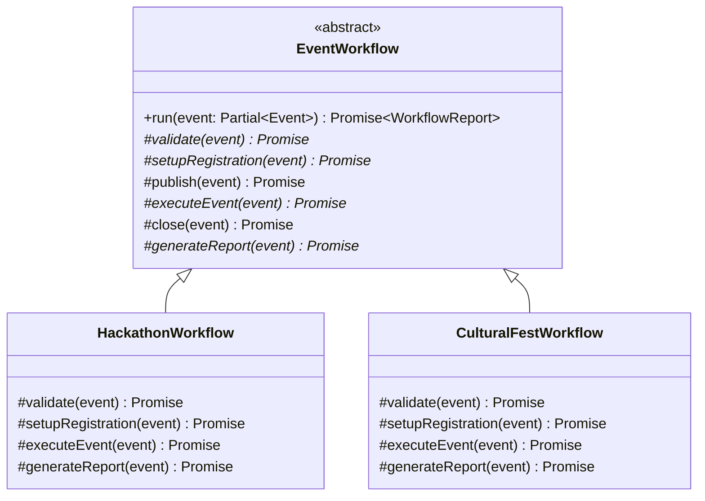

---

## 15. Strategy Pattern Diagram (PricingStrategy)

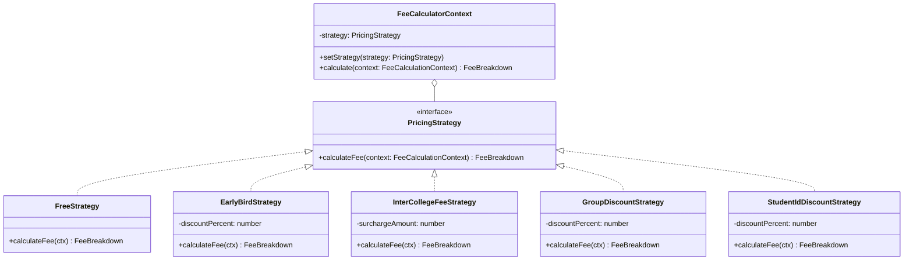

---

## 16. Memento Pattern Diagram (EventMemento)

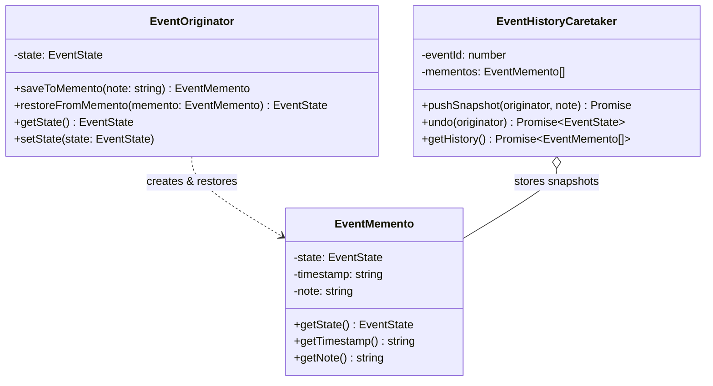

---

## 17. Model-View-Controller (MVC) Full-Stack Diagram

```mermaid
graph TD
    subgraph View Layer ["View Layer (React Frontend)"]
        V1["EventCard"]
        V2["OrganizerDashboard"]
        V3["CreateEventWizardModal"]
        V4["DuplicateEventModal"]
        V5["EventVersionModal"]
        V6["DesignPatternExplorer"]
    end

    subgraph Controller Layer ["Controller Layer (Express & api.ts)"]
        C1["EventController"]
        C2["RegistrationController"]
        C3["AuthController"]
        C4["AdminController"]
        C5["frontend/src/services/api.ts Client"]
    end

    subgraph Model Layer ["Model Layer (Repositories, DB & Services)"]
        M1["EventRepository"]
        M2["RegistrationRepository"]
        M3["MementoRepository"]
        M4["UserRepository"]
        M5["DatabaseManager (SQLite WASM)"]
        M6["Domain Entities (Event, User, Registration)"]
    end

    View Layer -- User Interactions & HTTP Fetch --> Controller Layer
    Controller Layer -- Queries & Transaction Commands --> Model Layer
    Model Layer -- Typed Domain Entities & Data Sets --> Controller Layer
    Controller Layer -- JSON HTTP REST Responses --> View Layer
    View Layer -- DOM Virtual Tree Rerenders --> View Layer
```

